# Screenshots

These screenshots show the 12 sheets of the configuration workbook for the `Part` ItemType.
Each screenshot shows the top-left part of the sheet.

## Packaging

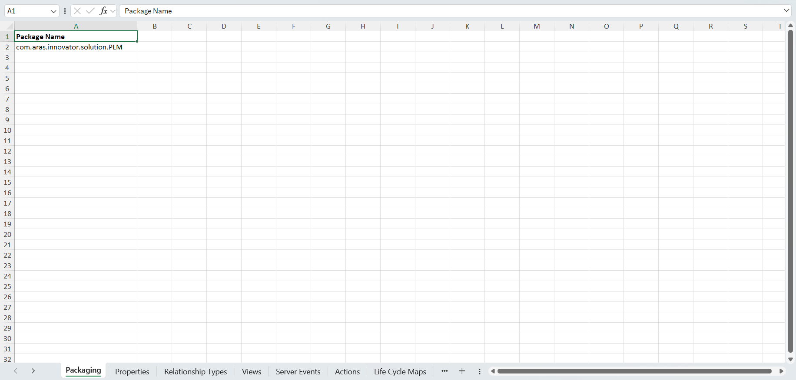

## Properties

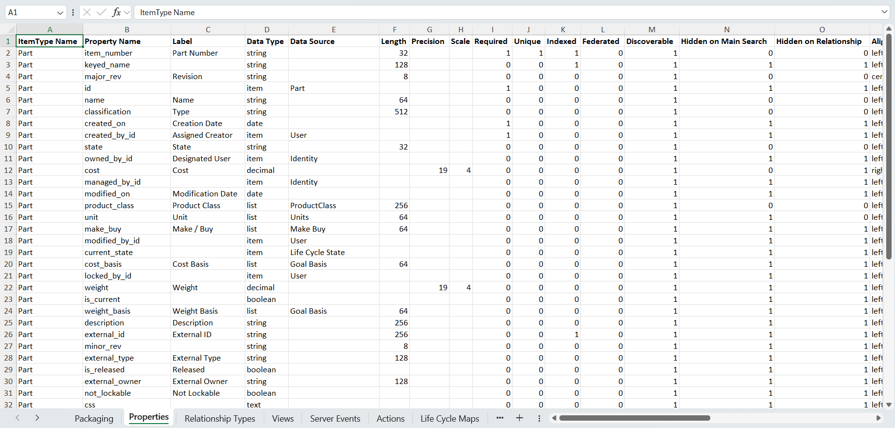

## Relationship Types

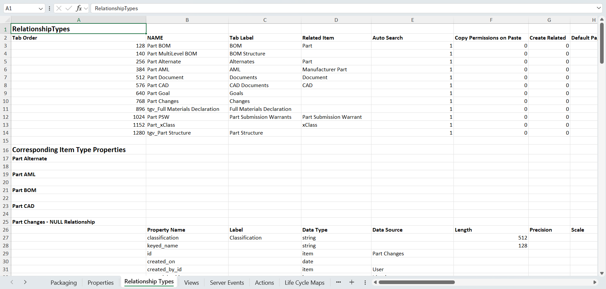

## Views

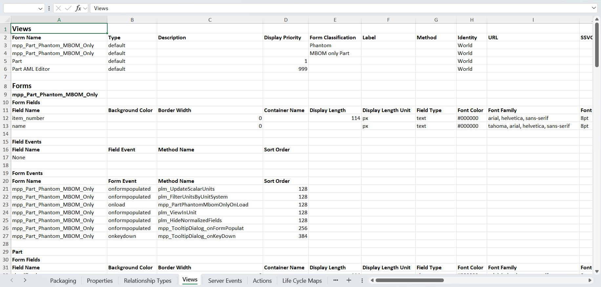

## Server Events

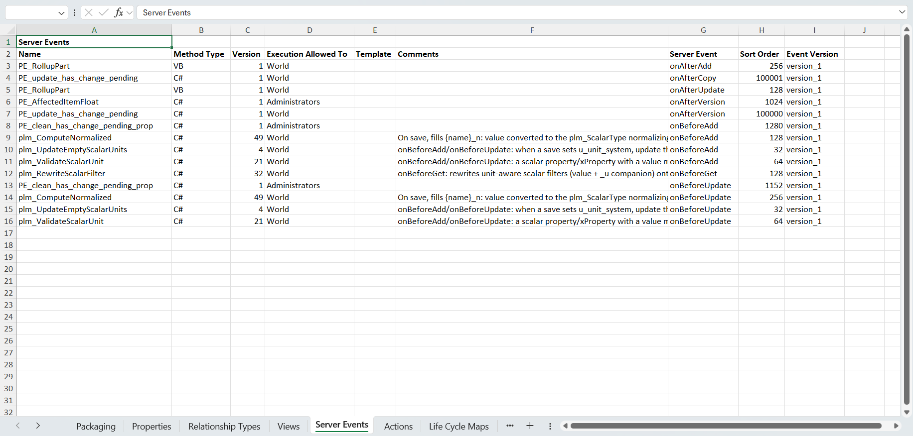

## Actions

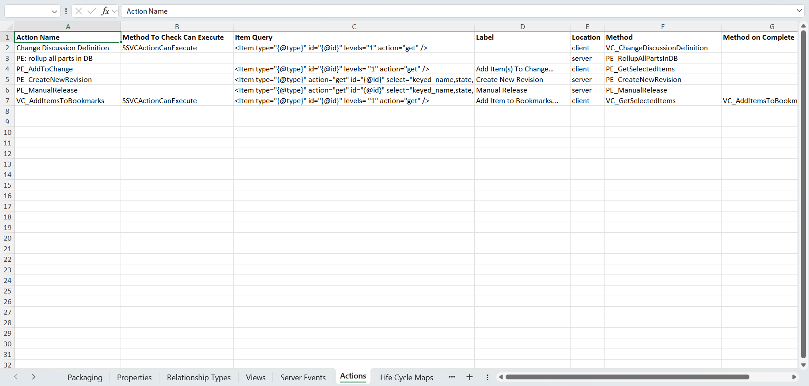

## Life Cycle Maps

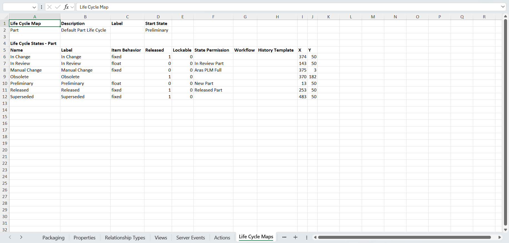

## Permissions

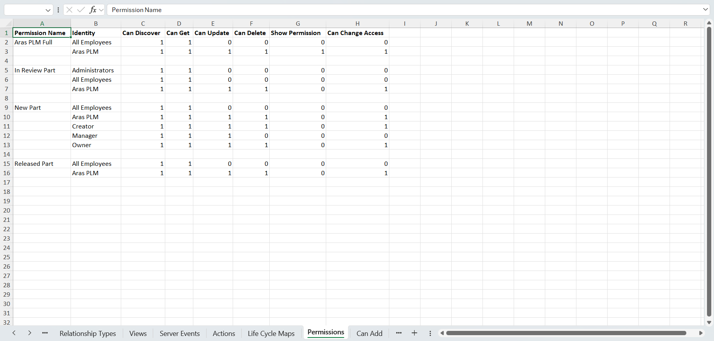

## Can Add

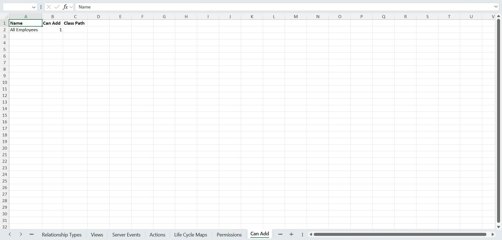

## Client Events

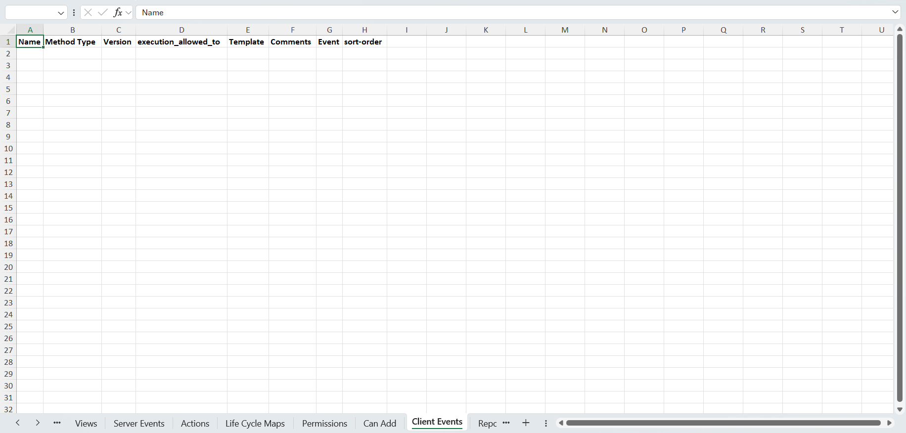

## Reports

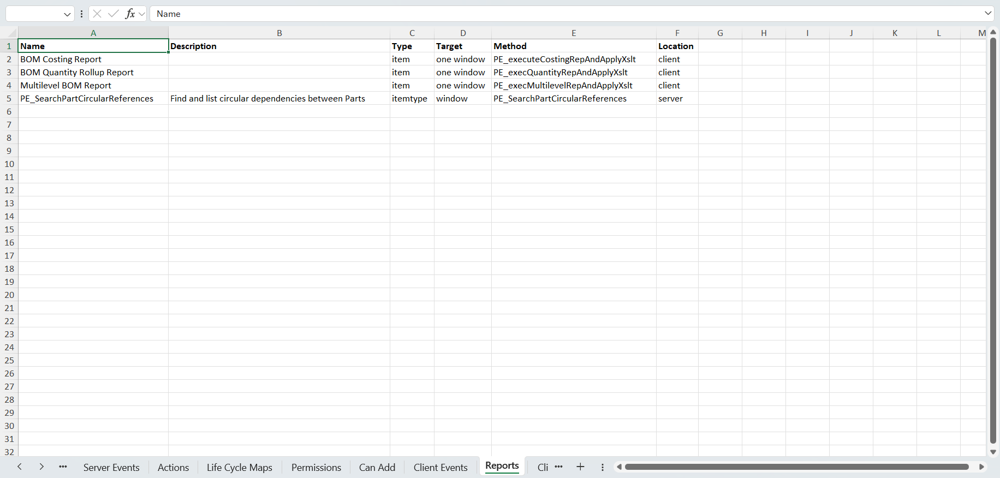

## Client Style (CUI)

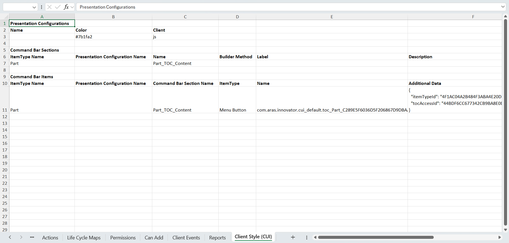
